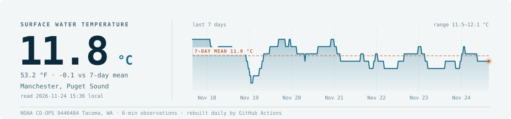

I'm Steven — I work at the **University of Washington**, where I study shellfish,
genomes, and the places those two things collide. Nearly everything I do ends up
in a repo somewhere: code, data, half-finished analyses, and the occasional idea
that didn't survive contact with the data.

<!-- WATER:START -->

`11.9 °C` in the water off Manchester, Puget Sound, Nov 25 15:18 local, via NOAA CO-OPS Tacoma, WA.
<!-- WATER:END -->

That number is real, and it's a decent indicator of where I am. If I've gone
quiet on here, odds are I'm standing in it — out at a shellfish farm doing the
part of this job that no amount of compute will do for me.

#### From the notebook

Whatever comes of either half — a methylation signal, a genome assembly that
finally behaves, or a bag of oysters that didn't — gets written up here.

<!-- NOTEBOOK:START -->

**[What Shapes Coral Methylation, Expression, and Physiology Over a Year](https://sr320.github.io/tumbling-oysters/posts/97-coral-multiomics/)**  
The E5 timeseries project sampled three corals four times over a year on Moorea:  
Nov 24, 2026 · Epigenetics · Transcriptomics

**[Tensor Decomposition and Elastic Net on the E5 Coral Timeseries](https://sr320.github.io/tumbling-oysters/posts/98-stdm-mosaic/)**  
workflow-stdm is the clean, reproducible version of the workflow from the 2026 eScience talk:  
Nov 24, 2026 · Epigenetics · Transcriptomics

**[Lean vs Lean](https://sr320.github.io/tumbling-oysters/posts/96-trout-lean-baseline/)**  
Rick asked whether we had compared our ecotype genomes to the published lean reference genome, and specifically lean to lean. We had all the pieces…  
Oct 16, 2026 · Genomics · Computing

Latest from [Tumbling Oysters](https://sr320.github.io/tumbling-oysters/) · refreshed daily by GitHub Actions
<!-- NOTEBOOK:END -->
